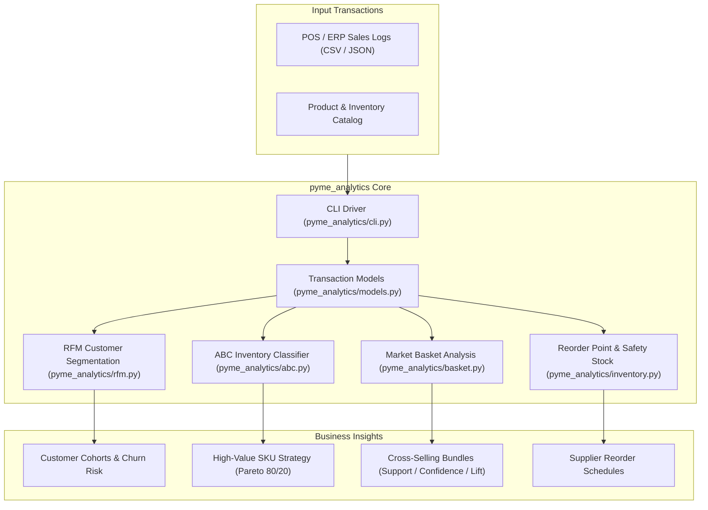
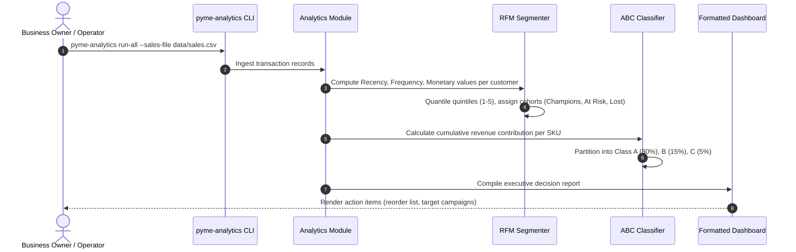

# 🏛️ PyME Data Analytics Architecture & Topology

Algorithmic business intelligence and decision-support library for Mexican small and medium enterprises (PyMEs). Delivers ABC inventory classification, RFM customer segmentation, market basket cross-selling analysis, and safety stock reorder forecasting. Built with Python 3.12, Pandas, Numpy, and Pydantic.

---

## 1. Technology Stack

| Layer | Technology | Details |
| :--- | :--- | :--- |
| **Runtime** | Python 3.12+ | Vectorized numerical computing and strict type contracts |
| **Data Engine** | `pandas` & `numpy` | High-performance tabular transformation and matrix operations |
| **Validation** | `pydantic` v2 | Transaction and product ledger schema validation |
| **Algorithms** | Scikit-learn / Custom | Apriori association rules, Pareto distribution, quantile scoring |
| **CLI & Export** | `rich` / `argparse` | Formatted terminal dashboards, markdown tables, and CSV exports |

---

## 2. System Topology & Component Graph



---

## 3. Analytical Pipeline Lifecycle



---

## 4. Directory Structure & Module Breakdown

```
pyme-data-analytics/
├── pyme_analytics/           # Core analytics library
│   ├── abc.py                # Pareto 80/20 inventory analysis by volume & revenue
│   ├── rfm.py                # Recency, Frequency, Monetary segmentation engine
│   ├── basket.py             # Market basket cross-selling association rules (Apriori)
│   ├── inventory.py          # Safety stock, lead-time variance & reorder calculation
│   ├── models.py             # Pydantic data schemas for sales, items, customers
│   ├── samples.py            # Synthetic business data generator for simulations
│   └── cli.py                # Terminal command-line interface & summary reports
├── tests/                    # Algorithmic test suite
│   └── test_analytics.py     # Deterministic checks on ABC, RFM, and reorder points
├── pyproject.toml            # Packaging metadata
└── requirements.txt          # Python dependencies
```
